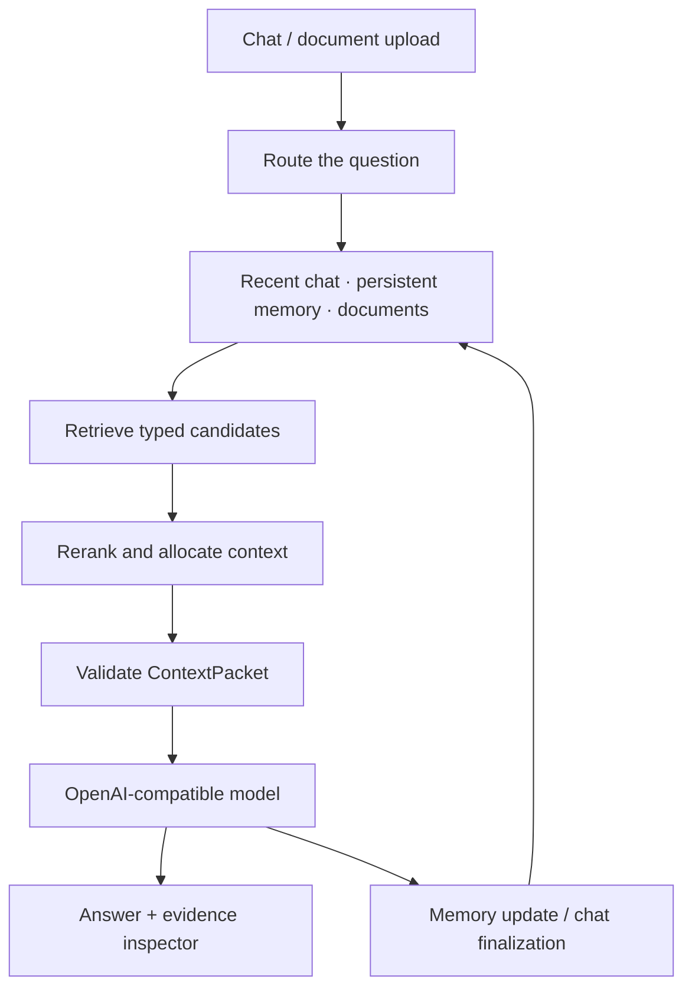
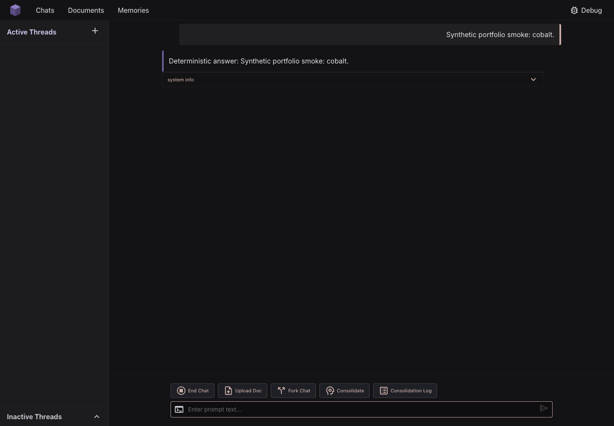

# Memory-Augmented Retrieval Chatbot

A conversational-memory and document-RAG prototype: it retrieves recent chat,
durable cross-chat facts, and uploaded documents before building an evidence-aware
LLM prompt. It addresses a practical problem: useful information outlives a
model's immediate conversation window, but retrieving everything wastes context
and makes answers harder to explain.

The engineering focus is the path from **routing → candidate retrieval → reranking
→ context budgeting → answer generation**, with provenance available in an Answer
Inspector. This is a two-person student project; my work focused on memory/retrieval
architecture and evaluation, as described below.

**Stack:** Python 3.12 · Chainlit + React · SQLite/sqlite-vec · Chroma ·
LangMem/LangChain · sentence-transformers · OpenAI-compatible inference.

**Verified:** 689 offline tests passing; React chat/lifecycle smoke passing with a
deterministic test model. [Verification scope](docs/TESTING.md).

[Run locally](#quick-start) · [Offline verification](#testing) ·
[Detailed architecture](docs/ARCHITECTURE.md)

## What it demonstrates

- Multiple retrieval sources normalized into typed `MemoryCandidate` contracts.
- Ranking and context allocation into a validated `ContextPacket`, with fallbacks.
- Durable memory and chat lifecycle: End Chat finalization, read-only history,
  and Fork Chat continuation.
- Same-turn document indexing/retrieval and raw-message provenance behind gists.
- Inspectable evidence, offline regression tests, and explicit benchmark limitations.

“Multi-agent” describes responsibility boundaries and selected LLM-backed
 decisions; loading, storage, retrieval, budgeting, and validation remain
 deterministic where practical.

## Architecture



SQLite is the source of truth for chats, structured memories and gists. sqlite-vec
indexes structured memories; Chroma indexes document chunks. LangGraph is an
optional diagnostic/shadow path; the default application orchestration is native.

<details>
<summary>Actual React UI — synthetic conversation, deterministic test model</summary>



This capture verifies the real frontend/backend integration, not live LLM quality.

</details>

## Project context and contributions

This repository is my post-project fork of a two-person TUM practical-course
project developed together with Josef Bureš.

My contributions included work on the memory/retrieval architecture and
evaluation, including routing, candidate retrieval, reranking, context-assembly
design, and proposing an LLM-assisted semantic-routing extension to the initial
rule-based router.

## Quick start

Requires **Python 3.12**, [uv](https://docs.astral.sh/uv/getting-started/installation/),
and **Node.js 22.12+**. First setup installs Python/Node dependencies. Local
embedding/reranker weights may download on the first application run; tests do
not download weights. No university infrastructure is required.

```bash
uv sync --locked
PUPPETEER_SKIP_DOWNLOAD=true npm --prefix braemon ci
cp .env.example .env
```

Choose one provider in `.env`:

**Ollama:** start Ollama separately and install a model yourself. No model is
provisioned by this repository.

```dotenv
LLM_PROVIDER=ollama
OLLAMA_BASE_URL=http://localhost:11434/v1
OLLAMA_MODEL=qwen2.5:3b
```

**DeepSeek:** supply your own API key. Calls incur provider charges.

```dotenv
LLM_PROVIDER=deepseek
DEEPSEEK_API_KEY=your-key
DEEPSEEK_MODEL=deepseek-flash
```

Then start backend and frontend:

```bash
uv run python startup.py -w
```

Open **http://localhost:5173**; the backend listens on port 8000. The bare
Chainlit interface is also available on port 8000. Use a synthetic fact in Chat A,
end the chat, then ask about it in Chat B and inspect the evidence. Upload a text
or PDF document to try same-turn document retrieval.

Custom endpoints and legacy `OPENAI_*` configuration remain supported. See
[providers and model limits](docs/PROVIDERS.md). The heavier cross-encoder startup
mode remains experimental. This is a local, single-user prototype; keep it on a
trusted machine.

## Testing

```bash
uv run pytest -q
uv run ruff check .
uv run python -m compileall -q app.py src evals tests scripts
```

The default suite isolates storage, disables dotenv loading, replaces inherited
provider credentials, blocks external sockets, and disables model downloads.
Browser tests are selected separately. Current results and exact commands are in
[Testing](docs/TESTING.md); the [39-failure triage](docs/TEST_TRIAGE.json) records
what was fixed rather than hiding the old baseline.

## Evaluation

Evaluation tooling covers document QA, structured memory, typed-memory workflows,
product behavior, MemoryAgentBench, and a LongMemEval pilot. Offline test success
checks engineering behavior; it does **not** establish general answer accuracy.

Historical answer-level results include MAB official metric **12/33** and
LongMemEval pilot metric **10/19**. These small course experiments were **not
rerun for this portfolio update**; the latter is not an official leaderboard
score. [Evaluation details](docs/EVALUATION.md) explain denominators and caveats.

## Limitations

- Fixed local identity; no multi-user authorization isolation.
- Broad summarization, temporal/multi-hop questions, and hard long-memory cases
  remain limited by retrieval and single-pass context selection.
- Embedding/reranker model weights and an inference endpoint are needed for a
  full application run. Small local models can be weak at structured extraction.
- Vector synchronization is best effort after a SQLite memory write. Failures
  are logged and inspectable; rebuild the derived index after recovery.
- Token estimates for unregistered models can be approximate; inspect context
  diagnostics and configure the endpoint's real context limit.

## More detail

- [Architecture](docs/ARCHITECTURE.md) · [Data lifecycle](docs/DATA_LIFECYCLE.md)
- [Provider configuration](docs/PROVIDERS.md) · [Testing](docs/TESTING.md)
- [Evaluation](docs/EVALUATION.md) · [Demo runbook](docs/DEMO_RUNBOOK.md)
- [Known limitations](docs/KNOWN_LIMITATIONS.md) · [Troubleshooting](docs/TROUBLESHOOTING.md)
- [Frontend](braemon/README.md) · [Screenshot capture](docs/screenshots/README.md)
